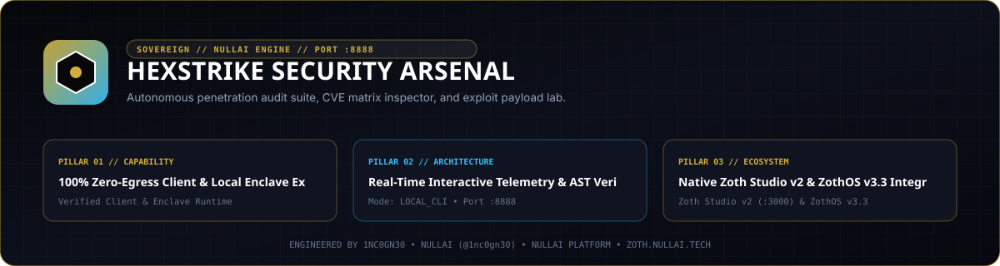

<div align="center">
  
</div>

# HexStrike Security Arsenal

HexStrike (`NullAI-HexStrike-AI-Terminal`) is a local-first offensive security command synthesizer, non-destructive TCP socket sweeper, CVE/EPSS reference workstation, and Model Context Protocol (MCP) JSON-RPC 2.0 stdio server. It indexes 156 Kali and Parrot security binaries across 11 operational categories and runs with zero external telemetry on loopback port `127.0.0.1:8138`.

- **Zoth Studio v2 Dossier**: [https://zoth.nullai.tech/tools/hexstrike-arsenal](https://zoth.nullai.tech/tools/hexstrike-arsenal)
- **Standalone Loopback Daemon**: `http://127.0.0.1:8138`
- **Support Development**: [https://buy.stripe.com/3cIfZg27PdKo2D64Ocfw40X](https://buy.stripe.com/3cIfZg27PdKo2D64Ocfw40X)

---

## Overview

HexStrike provides a deterministic interface for red-team reconnaissance, command generation, and local port auditing without transmitting target profiles or scan logs outside the local host (`~/.hexstrike/intel.json`).

Key capabilities:
- **156-Tool Security Catalog**: Searchable JSON index (`ui/src/data/tools.json`) spanning Exploit (48), Web (32), Recon (30), Post-Exploit (14), OSINT (9), Documentation (6), Neural (5), Password (5), Wordlist (3), Container (2), and Cloud (2) tools, each annotated with `usefulness` (1-10), `difficulty`, and `tags`.
- **Canonical Command Synthesizer**: Sanitizes shell metacharacters (`;`, `&`, `|`) from target inputs and generates reproducible invocation strings for tools such as `nmap`, `masscan`, `amass`, `gobuster`, `ffuf`, `nikto`, `sqlmap`, `nuclei`, `hydra`, `hashcat`, `metasploit`, and `trivy`.
- **TCP Socket Port Sweeper**: Zero-dependency Python `socket` probe (`run_socket_port_scan`) for rapid loopback and internal network reachability verification.
- **CVE & EPSS Reference Matrix**: Built-in high-impact vulnerability reference (`CVE-2024-6387`, `CVE-2024-3094`, `CVE-2024-21626`, `CVE-2023-44487`, `CVE-2021-44228`) with CVSS, EPSS, MITRE ATT&CK technique IDs, and remediation notes.
- **Native MCP Server**: JSON-RPC 2.0 over `stdio` (`mcp_server.py`) exposing 5 structured tools to Claude Desktop, Cursor, Hermes Agent, and OpenCode.

---

## Architecture

| Component | Path | Responsibility |
| :--- | :--- | :--- |
| Standalone HTTP Daemon | `server.py` | Zero-dependency `ThreadingMixIn` HTTP server on `127.0.0.1:8138` serving `public/` and `/api/*` |
| Web Workstation UI | `public/index.html` | Single-file dark workstation for command synthesis, live TCP socket sweeps, CVE lookup, and catalog filtering |
| CLI Entrypoint | `cli.py` | Scriptable CLI supporting `tools`, `cmd`, `scan`, `report`, `mcp`, and `serve` with `--json` output |
| MCP Server | `mcp_server.py` | JSON-RPC 2.0 `stdio` server (`protocolVersion: 2024-11-05`) and shared catalog/scanner core |
| Node / Electron Launcher | `bin/hexstrike.js` | Unified wrapper delegating CLI flags to `cli.py`, `web` to `server.py`, or GUI mode to Electron |
| Braille TUI | `bin/hexstrike-arsenal-tui` | ZothOS v3.4.0 Unicode `U+2800` 2x4 Braille terminal telemetry monitor |

---

## Quickstart

Clone the repository and run the standalone workstation or CLI directly with Python 3.10+:

```bash
git clone https://github.com/NullAITech/NullAI-HexStrike-AI-Terminal.git
cd NullAI-HexStrike-AI-Terminal

# Verify the CLI
python3 cli.py --help
python3 cli.py tools --category Recon --json

# Launch the standalone web workstation on http://127.0.0.1:8138
python3 server.py
```

Optional environment variables for `server.py`:
- `HOST` — Bind address (default: `127.0.0.1`)
- `PORT` — Listen port (default: `8138`)

If you also want to build the optional React/Vite frontend (`ui/`) or Electron desktop shell:

```bash
npm install
npm run build:ui
```

---

## CLI & MCP Usage

### Command-Line Interface (`cli.py`)

All subcommands accept `--json` for structured machine-readable output:

```bash
# Filter the 156-tool catalog by category, tag, or minimum usefulness score (1-10)
python3 cli.py tools --category Web --min-score 9
python3 cli.py tools --tag sqli --json

# Synthesize canonical command syntax for a target
python3 cli.py cmd nmap 127.0.0.1
python3 cli.py cmd sqlmap target.local --json

# Execute a non-destructive TCP socket sweep
python3 cli.py scan 127.0.0.1 --ports 22,80,443,3000,8138

# Generate a Markdown assessment summary
python3 cli.py report target.local --json

# Start the HTTP workstation daemon on 127.0.0.1:8138
python3 cli.py serve --host 127.0.0.1 --port 8138

# Start the JSON-RPC 2.0 MCP server on stdio
python3 cli.py mcp
```

### Model Context Protocol (`mcp_server.py`)

Add HexStrike to `claude_desktop_config.json`, Cursor MCP settings, or Hermes Agent configuration:

```json
{
  "mcpServers": {
    "hexstrike": {
      "command": "python3",
      "args": ["/path/to/NullAI-HexStrike-AI-Terminal/mcp_server.py"]
    }
  }
}
```

Exposed MCP tools:
- `hexstrike_list_tools` — Filter the 156-tool catalog by `category`, `tag`, and `min_usefulness`.
- `hexstrike_generate_cmd` — Generate sanitized CLI invocation syntax for `tool` and `target`.
- `hexstrike_port_scan` — Run a TCP socket sweep against `host` (default `127.0.0.1`) and `ports`.
- `hexstrike_target_intel` — Read stored local target history from `~/.hexstrike/intel.json`.
- `hexstrike_generate_report` — Render a Markdown red-team assessment template for `target`.

---

## REST API Endpoints

When running `python3 server.py` on `http://127.0.0.1:8138`:

| Method | Path | Parameters / Body | Description |
| :--- | :--- | :--- | :--- |
| `GET` | `/health`, `/api/health` | None | Service health, version (`3.1.0`), `arsenal_count`, and `mcp_tools` count |
| `GET` | `/api/status`, `/api/analytics` | None | Service capabilities and built-in CVE/EPSS matrix |
| `GET` | `/api/tools` | `?category=<str>&min_score=<int>` | Filtered list of tools from the 156-tool catalog |
| `GET` | `/api/cmd` | `?tool=<id>&target=<host>` | Synthesized CLI command string |
| `GET` | `/api/scan` | `?target=<host>&ports=22,80,8138` | Live TCP socket probe results (`open_ports`, `scanned_count`) |
| `POST` | `/execute`, `/api/execute` | `{"tool":"nmap","target":"127.0.0.1","ports":[3000,8138]}` | Combined command synthesis and TCP socket probe |

---

## ZothOS & Zoth Studio Integration

- **Zoth Studio v2**: Indexed as `hexstrike-arsenal` at [https://zoth.nullai.tech/tools/hexstrike-arsenal](https://zoth.nullai.tech/tools/hexstrike-arsenal) (`http://127.0.0.1:3000/tools/hexstrike-arsenal`), polling `http://127.0.0.1:8138/health`.
- **ZothOS v3.4.0 CLI & Braille TUI**: Pre-linked in `/usr/local/bin/hexstrike-arsenal` and `/usr/local/bin/hexstrike-arsenal-tui`:
  ```bash
  hexstrike-arsenal --help
  hexstrike-arsenal tools --json
  hexstrike-arsenal-tui --status
  ```

---

## Testing & Verification

Run the automated `pytest` unit and MCP stdio integration suite:

```bash
python3 -m pytest -q
```

Verify secret hygiene with Gitleaks:

```bash
gitleaks detect --source . --no-banner --redact
```

---

## License

MIT License. Copyright (c) 2026 1nc0gn30 (`@1nc0gn30`, [https://1nc0gn30.si](https://1nc0gn30.si)) & NullAI ([https://nullai.tech](https://nullai.tech)). See [LICENSE](LICENSE).
